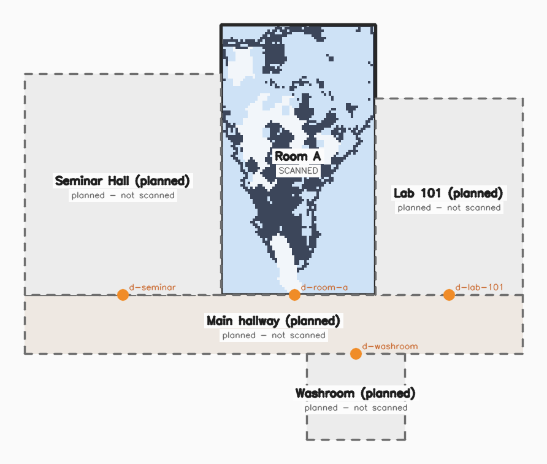

# Stage 4: building map (navgrid, rooms, building graph, pathfinding)

CPU only: numpy, scipy, opencv, pyyaml. No torch, no open3d.
`pip install -r requirements-building.txt`

```
python -m pipeline.building.navgrid  --scene web/scenes/cliproom            # navgrid.json + floorplan.png/svg
python -m pipeline.building.segment  --synthetic                            # rooms + doors from a navgrid
python -m pipeline.building.compose  --spec pipeline/building/demo_building.yaml \
                                     --out web/scenes/building.json --plan pipeline/building/demo_building
python -m pipeline.building.astar    --building web/scenes/building.json --from=0,-1 --to=6,-3
python -m pytest tests/building -q
```
(Use `--from=x,z` with `=` when a coordinate starts with `-`.)

| file | what |
|---|---|
| `splat.py` | read 3DGS PLY centres (opacity is a logit, scale is log); filter by opacity and size |
| `align.py` | scene to world alignment: `scene.json.toWorld`, or our own estimate cached in `cache/<id>_alignment.json` |
| `navgrid.py` | rasterise to the `navgrid.json` contract, write `floorplan.png/svg` |
| `segment.py` | free space to rooms/hallway polygons plus doors (distance transform + watershed + doorway merging) |
| `compose.py` | YAML spec to `web/scenes/building.json`, with validation and a plan render |
| `astar.py` | reference A* on a navgrid plus door-graph routing across spaces (the JS port follows this file) |
| `grid.py`, `geom.py`, `floorplan.py` | navgrid model and RLE, polygon helpers, renderers |

## The demo that is committed



- `web/scenes/cliproom/navgrid.json`: 67 x 112 cells at 0.1 m, origin (-3.2, -10.9).
- `web/scenes/building.json`: **Room A is the only real scan** (`status: scanned`, `sceneId: cliproom`).
  Main hallway, Lab 101, Seminar Hall and Washroom are **planned placeholders that have not been scanned**
  (`status: planned`, `sceneId: null`, names end in "(planned)"). They exist so the overview,
  click-to-enter and cross-room routing can be shown.
- Room A's polygon is the bounding rectangle of everything the scan observed (6.3 x 11.0 m). Its door
  `d-room-a` is at (0, 0.3), which is 0.3 m behind the first camera (the scan starts at the room entrance).

### Alignment used for cliproom

`web/scenes/cliproom/scene.json` did not exist on this branch, so `navgrid.py` estimated the alignment and
wrote it to `cache/cliproom_alignment.json`. It never writes scene.json, because the reconstruction
stage owns that file. Once scene.json has `toWorld`, re-run `navgrid.py`. The scene.json value wins over the
cache, and the navgrid records which one it used in `navgrid.json.alignment`.

Estimated `toWorld` (row-major, scene to world):
```
[[ 1.1448 -0.1262  0.0533  0.    ]
 [-0.1177 -1.1357 -0.1603  0.2169]
 [ 0.0700  0.1537 -1.1405  0.    ]
 [ 0.      0.      0.      1.    ]]
```
How it was estimated (`align.estimate_alignment`):
1. **Gravity / floor.** RANSAC finds a "supporting plane": the score is the inlier count minus 3 times
   the number of points below the plane, the normal must be within 35 degrees of the mean camera image-down
   axis, and the median camera must be above the plane. The result is refined by least squares.
   A plain largest-plane RANSAC fails on this clip: the monocular depth makes the cloud fan-shaped,
   and a dense layer that sits above the real floor wins.
2. **Scale.** `metric: false`, so the scale comes from a cue. `--scale-cue auto` uses the floor-to-ceiling
   span (98th-percentile height) and assumes a 3.0 m ceiling (`--room-height`). It falls back to camera height
   (1.4 m, `--camera-height`) when there is no ceiling in view. On cliproom the near field is so
   compressed that the camera would sit 0.14 units above the floor, and a 1.4 m camera-height cue would
   blow the room up to about 50 m. The room-height cue gives a 6.3 x 11 m room, which fits the photos.
3. **Yaw.** Manhattan alignment rotates about up so the x/z histograms of wall points are as
   sharp as possible. Of the four 90-degree solutions it keeps the one where camera 0 looks along -Z.
4. **Origin.** Camera 0 projected onto the floor, so the room entrance is (0, 0).

## navgrid.json (contract in docs/ARCHITECTURE.md)

`cells[j][i]`, row-major over z then x. Values are 0 free, 1 blocked, 2 unknown. RLE `[[value, run], ...]`.
**The grid is already inflated by the walker radius (`inflateRadius`, 0.2 m)**, so a planner treats the
walker as a point. Extra, optional fields: `inflateRadius`, `obstacleBand`, `obstacleMinPoints`,
`rawBlockedCells`, `freeComponents`, `trajectory` ([[x,z], ...], the camera path, about 60 samples) and
`alignment` ({source, toWorld}).

How it is built (`navgrid.build_navgrid`):
1. World points come from the splat centres with opacity >= 0.25 and size <= p98.
2. A local ground field (`--flat-ground` turns it off for metric scans) is the 10th-percentile y per
   cell, median-filtered over 1.5 m. Monocular floors bend with distance, and this keeps the obstacle band
   relative to the floor actually under each cell.
3. Per cell it counts floor points (|y| < 0.15) and obstacle-band points (0.15 to 1.8 m).
4. The footprint is the observed cells after closing and hole filling, keeping the largest component
   plus any component the trajectory touches.
5. A cell is blocked when the smoothed obstacle count is at least the min points (auto: the median of
   non-zero cells), the obstacle count is at least 0.5 of (floor + obstacle), and the obstacle density is
   at least 1.5x the mean in its 1 m neighbourhood. Walls and furniture are concentrated; depth noise is
   a diffuse haze. Blobs under 4 cells are dropped, and the footprint rim is sealed as wall.
6. A cell is free when it is inside the footprint, floor is observed there, and it is not blocked (with
   small closing). The camera trajectory, with a 0.3 m radius, is always free, because the person
   walked there.
7. Obstacles are inflated by 0.2 m into free space (unknown stays unknown, and the trajectory stays free).
   Free pockets under 0.5 m^2 that do not touch the trajectory become unknown.

`floorplan.png/svg`: free is light, blocked is dark, unknown is grey. The orange line is the known-area
outline and the green line is the camera path. The SVG uses world metres as user units (x right, z
down), so building.json coordinates can be overlaid directly.

**Sample quality caveat.** cliproom is a relative-scale monocular reconstruction (Depth Anything +
RGB-D odometry). Its geometry is a stretched fan, not a clean box. The navgrid has the right extent and
the walls are sealed. However, the people and tables 2 to 6 m from the entrance merge into one obstacle
blob, so the far half of the room (free area at the top of the plan) is **not connected** to the entrance
corridor. A* from the entrance into the far half reports unreachable. A metric (ARCore) capture or a
better depth model fixes this, and the pipeline needs no changes. `--keep-connected` drops the
unreachable pockets instead.

## Room segmentation (`segment.py`)

1. D is the Euclidean distance transform of the free mask, in metres.
2. Markers are the 8-connected components of `D >= door_width/2 + cell` (door_width = 1.0 m). Doorways are
   narrower than this, so room cores separate there.
3. A priority-flood watershed (highest D first, 4-connected) grows the markers over all free cells.
4. Two regions that touch share an opening. If the opening is wider than 1.6 m, it is not a door and the
   regions merge. Regions under 1.5 m^2 merge into the neighbour they share the most boundary with.
5. Every remaining shared boundary is a door: its position is the boundary cell nearest the mean, and its
   width is the boundary length.
6. A region is a hallway if its min-area rectangle has aspect >= 2.8 and short side <= 3 m. Otherwise it
   is a room.
7. The polygon is the outer contour, Douglas-Peucker simplified (0.15 m), in world x,z.

`python -m pipeline.building.segment --synthetic` runs it on a built-in plan: a 14 x 2 m hallway with three
rooms and 0.9 m doors. It finds 3 rooms, 1 hallway and 3 doors (see `synthetic_segments.png`). On the
single-room cliproom scan it only yields fragments, which is expected.

## building.json

The contract is in docs/ARCHITECTURE.md. Additive fields written by `compose.py`:

| field | meaning |
|---|---|
| `spaces[].status` | `scanned` (has `sceneId`) or `planned` (floor-plan polygon only, not scanned yet) |
| `spaces[].navgrid` | `scenes/<id>/navgrid.json`, relative to the web root (like `scenes`) |
| `spaces[].placement` | row-major 4x4, scan world frame to building frame (rotation about +Y, then translation). Identity in the demo. If it is not identity, fold it into scene.json `toWorld` and rebuild the navgrid, or apply it after `toWorld` in the viewer |
| `spaces[].area`, `center`, `footprintFit`, `note` | m^2, polygon centroid [x,z], share of the scan's known cells inside the polygon, free text |
| `doors[].width` | metres (optional) |

Spec format: see the docstring at the top of `compose.py` and `demo_building.yaml`. A door `position` may be
`[x,z]`, `[x,y,z]` or `auto` (the midpoint of the longest shared edge). A scanned space may use
`autoPlace: {door, inward, inset}` instead of `placement`. In that case its entrance (trajectory start,
camera looking along local -Z) is placed `inset` metres inside the door, facing `inward`.

Validation (errors exit 1): duplicate ids, unknown floors or spaces, polygons with fewer than 3 vertices
or zero area, overlap between two spaces on a floor greater than 0.05 m^2 (rasterised at 5 cm, with shared
edges not counted), and a door more than 0.15 m from the boundary of either of its spaces. Warnings: a
scan's known cells less than 95% inside its polygon, spaces not reachable through doors, and a missing
scene.json.

## Pathfinding: the exact algorithm (port this to JS)

### Grid A* (`astar.astar`)
- **Passable**: the cell is in bounds and its value is 0 (free). With `allowUnknown`, 2 is also passable.
- **Neighbours**: tried in this order, with (di, dj, cost): E (1,0,1), W (-1,0,1), S (0,1,1), N (0,-1,1),
  SE (1,1,√2), SW (-1,1,√2), NE (1,-1,√2), NW (-1,-1,√2). Here i is x (column) and j is z (row).
- **No corner cutting**: a diagonal move (di, dj) is allowed only if both (i+di, j) and (i, j+dj) are
  passable.
- **Heuristic**: octile, `h = (dx + dy) + (√2 - 2)·min(dx, dy)` in cells (admissible and consistent).
- **Open list**: a binary heap ordered by `(f = g + h, h, insertionCounter)`. Ties go to the lower h, then
  first-in. A node is expanded once (closed set). A neighbour is relaxed when `g_new < g_old - 1e-12`.
- **Result**: the cell path from start to goal, and the cost in cells (multiply by `cellSize` for metres).
  If the start or goal is not passable or the open list empties, the result is unreachable.
- **World wrapper (`path_world`)**: `cell = floor((x - x0)/cs), floor((z - z0)/cs)`. If that cell is not
  passable, it snaps to the nearest passable cell by 4-connected BFS (order E, W, S, N), within
  `snap/cs` steps (0.6 m, or 1.0 m for building legs), after clamping into the grid. The polyline is
  `[start_xz, centres of path cells..., goal_xz]`, and its length is the sum of segment lengths.

### Building graph and cross-space routing (`astar.Building.route`)
- **Nodes**: every door (position `[x, y, z]`, using x,z) plus temporary nodes `S` (start) and `T` (goal).
- **Space membership**: a point is in the first space, in `spaces[]` order, whose polygon contains it
  (even-odd rule). Each door belongs to both spaces in `between`. S belongs to the start space and T
  to the goal space.
- **Edges**: for every space, connect every pair of its member nodes. The weight is the walking distance
  inside that space:
  - scanned space with a navgrid: `path_world` on that navgrid with a 1.0 m snap. The edge is dropped if
    the result is unreachable.
  - planned space, or no navgrid: a straight segment, with Euclidean length.
- **Search**: Dijkstra from S. The heap is ordered by distance. Edges out of a node are relaxed in order
  of (weight, neighbour id). It stops when T is popped.
- **Same space**: if start and goal are in the same space, the route is a single leg in that space, with
  no graph.
- **Output**: `spaces` alternates space and door ids, for example
  `room-a -> d-room-a -> hall -> d-lab-101 -> lab-101`. `polyline` is the concatenated legs in world
  [x,z] (y = floor elevation), and `length` is in metres.
- **Scope**: single floor. Stairs and lifts are not modelled yet. Use `floor` on spaces once multi-floor
  scans exist.

Example (demo building):
```
$ python -m pipeline.building.astar --building web/scenes/building.json --from=0,-1 --to=6,-3
route: room-a -> d-room-a -> hall -> d-lab-101 -> lab-101
length: 11.00 m, 17 points
```
